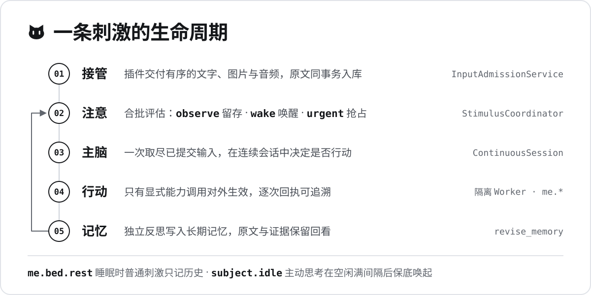

<p align="center">
  
</p>

<p align="center">
  <a href="docs/architecture.md">架构与调用链</a> ·
  <a href="docs/configuration.md">配置说明</a> ·
  <a href="docs/behavior.md">主体运行行为</a> ·
  <a href="docs/input-materials.md">输入材料契约</a> ·
  <a href="docs/distribution.md">构建与分发</a> ·
  <a href="CONTRIBUTING.md">贡献指南</a>
</p>

**Purrcept Engine** 是 Purrcept 的连续主体宿主。它不是一问一答的聊天机器人：
QQ 消息、语音和空闲计时都作为**刺激**进入同一个主体；注意模型判断
是留存、唤醒还是抢占，主脑在连续会话里自己决定要不要行动，而真正对外生效的
只有显式能力调用。每条输入、模型请求和行动回执都留在同一个 SQLite 库里。

## 主体能做什么

主脑通过 `me.*` 能力与世界交互。下面是一轮思考中可能出现的真实能力调用
（参数从略）：

```python
me.phone.qq.file_url(file_id=...)  # 取得私聊或群文件的下载链接
me.notebook.save_file(url=..., path="attachments/qq/报告.pdf")
me.computer.screenshot()  # 原图入库，并返回本地 JPEG 路径
me.phone.qq.send(..., images=[path])  # 把截图发回 QQ
me.microphone.speak(...)  # 合成并播放语音
me.bed.rest(...)  # 睡觉：普通刺激只记历史
```

每次调用都有逐次回执；未知结果不会被自动重放。用 `uv run purrcept-engine catalog`
可以列出当前配置实际装配的能力目录。

## 为什么是“持续主体”

- **注意分级，而不是有消息就回。** 刺激协调者统一合批：`observe` 留在收件箱，
  `wake` 请求下一次思考，`urgent` 尝试抢占旧生成。QQ 私聊和直接 @ 是保底唤起。
- **只有行动对外生效。** 主脑的最终文字属于内部结果；能力在隔离的 Windows Worker
  中执行，取消等待不会撤销已开始的行动。
- **一个库保存全部事实。** 宿主先取得数据目录锁，输入原文、媒体与待处理状态同事务
  写入 `engine.sqlite3`，请求与回执都可追溯。
- **会睡觉，也会主动想起你。** `me.bed.rest` 后只有高优先刺激能唤醒主脑；开启主动
  思考后，空闲满间隔会以 `subject.idle` 保底唤起一次。
- **长期记忆靠反思，不靠聊天记录。** 独立记忆整理通过 `revise_memory` 有据写入，冲突
  记忆保留双向反证与版本。
- **可以主动评价她的行为。** WebUI“行为审查”展示当轮刺激和完整行动，可选择
  好/坏并留言；评价持久交给主脑、局部行为评审与记忆整理，分别保留交接责任。

## 工作方式

<p align="center">
  
</p>

主脑每次被唤醒时原子取尽已提交输入，运行中不再拉取新刺激；注意模型只是被调用的
批次评估器，不拥有定时、提交或抢占。完整规则见 [主体运行行为](docs/behavior.md)。

## 内置能力

所有插件都需要在 `purrcept.toml` 中显式启用；纯配置声明不会打开设备。

| 插件 | 能力 | 额外依赖 |
| --- | --- | --- |
| `notebook` | 笔记、局部编辑、技能与附件保存（`me.notebook.*`） | — |
| `clock` | 读取时间、设置闹钟（`me.clock.*`） | 非 UTC 时区需 `time` |
| `bed` | 睡眠与起床（`me.bed.*`） | — |
| `qq` | 经 OneBot WebSocket 收发消息、文件与 QQ 空间（`me.phone.qq.*`） | `qq` |
| `computer` | 连接电脑、截图、连续观察与宿主 PowerShell 命令（`me.computer.*`） | — |
| `browser` | 搜索、打开、阅读网页（`me.computer.browser.*`） | `browser` |
| `meme` | 中文梗检索、详情、本地收藏与每日刺激提醒（`me.computer.meme.*`） | 非 UTC 时区需 `time`；[说明](src/purrcept_engine/plugins/meme/README.md) |
| `microphone` | 语音合成与播放 | FFmpeg / FFplay |
| `voice_input` | 收音、VAD 与 ASR | `voice-input` |
| `live2d` | VTube Studio 身体表达（`me.live2d.*`） | `live2d` |

看图能力 `me.view_image` 由宿主默认装配。外部插件通过已安装包的 `module:attribute`
或配置目录下的 `local/包名:factory` 显式加载。根目录 `plugins/` 是使用者自己的
插件工作区，不入库、不随包分发；`src/purrcept_engine/plugins/` 中的内置插件随包提供。

## 快速开始

> [!IMPORTANT]
> 目前支持 **Windows x64 + Python 3.12**。Core、Purrcept LiteLLM 和官方 LiteLLM
> 均从 PyPI 安装，无需同级 SDK 源码或本地补丁 wheel。

### 1. 安装

在 PowerShell 中克隆本仓库并创建环境：

```powershell
git clone https://github.com/Windpicker-owo/Purrcept-Engine.git
cd Purrcept-Engine
uv sync --locked
```

也可在自己的 Python 3.12 虚拟环境中执行 `python -m pip install .`。
可选面板、QQ 与时钟依赖按需安装，例如 `uv sync --locked --extra web --extra qq --extra time`。
浏览器、声音和收音还需准备浏览器程序、FFmpeg 或 VAD 模型，见对应插件说明。

### 2. 填写模型和主体

运行 `uv run purrcept-engine init` 生成完整模板，已有配置不会覆盖。初次使用建议
将其替换为 [最小可交互配置](docs/configuration.md#最小可交互配置)，让一个生成模型
承担前台、注意、反思和摘要，再逐步拆分模型、开启插件。

| 必须理解的配置 | 如何填写 |
| --- | --- |
| `[models.名称]` | `model` 填 `openai/实际模型名`，`api_base` 填服务端的完整兼容地址，`api_key` 填明确凭据；不会自动选择环境中的替代端点。 |
| `context_window` / `max_output_tokens` | 填端点真实窗口和输出上限；输出必须小于总窗口，模板值只是示例。 |
| `supports_contents` | 按实际传输能力声明文字、图片和音频；统一估算文本 token、图片尺寸和音频时长，无需配置计量规则。 |
| `[subject]` | `foreground`、`reflection`、`summary` 引用已声明的生成模型名称；`attention` 可引用同一个生成模型，或独立专用判断模型。 |
| `console = true` | 开启终端输入和 `me.console.output` 能力。每行文字作为刺激接管，主体自行决定是否表达。 |
| `[host] data_dir` | 保存 `engine.sqlite3`、媒体和日志，相对配置文件目录解析；同目录不能同时启动两个实例。 |
| `[[plugins]]` | 显式启用能力。添加数组表前删除模板顶层 `plugins = []`；安装 extra 不等于启用插件。 |

角色卡、预算、QQ 接收范围、插件示例和常见错误见 [配置说明](docs/configuration.md)。
本地 `purrcept.toml` 已被 Git 忽略，请只在自己的配置中填写真实密钥。

### 3. 校验并启动

```powershell
uv run purrcept-engine check
uv run purrcept-engine catalog
uv run purrcept-engine run
```

`check` 只校验结构、引用与插件声明，不探测端点；`catalog` 显示当前实际装配的能力。
启用 `console` 后在终端输入一行文字并回车。模型的内部最终文字不自动成为回复，
只有显式输出能力会表达。可先运行 `uv run python examples/action.py` 离线验证
控制台能力和真实 Worker。Ctrl+C 请求关闭，关闭期间再按一次强制退出。

安装 `web` extra 并在 `[web]` 中设置 `enabled = true` 后，启动会打印本机面板地址，
默认端口 `8765`。面板静态资源随包提供，使用者无需 Node 或 Design 源码；
页面展示实际状态和逐项行动结果，关闭浏览器不会停止宿主。

已有 Engine 数据升级前，请停止宿主并备份完整数据目录，具体规则见
[数据格式与升级](docs/behavior.md#数据格式与升级)。

## 架构一览

```text
src/purrcept_engine/
├── app/              配置、显式装配、Host 生命周期，以及 CLI/Web/调音室入口
├── domain/           主体、执行契约、活动、认识、上下文和业务值
├── infrastructure/   SQLite、模型 SDK、隔离执行器与进程等资源实现
├── plugin_system/    插件及替换执行器的统一公开契约
└── plugins/          显式启用的具体设备与应用业务
```

阅读入口：从 [`EngineHost`](src/purrcept_engine/app/host.py) 进入
[`EngineAssembly`](src/purrcept_engine/app/bootstrap.py) 看装配，再进入 `SubjectService`
看注意、前台与后台编排。嵌入调用可用 `EngineHost.execute` 明确执行行动，示例见
[`examples/action.py`](examples/action.py)。完整调用链见 [代码架构与调用链](docs/architecture.md)。

## 开发与验证

```powershell
$env:LITELLM_LOCAL_MODEL_COST_MAP = "True"
uv run python -m pytest -q
uv run ruff check src tests examples scripts
uv run ruff format --check src tests examples scripts
uv run pyright
uv run python -m compileall -q src tests examples scripts
uv run python -m build
```

类型检查使用 strict Pyright。离线验收在命令级设置 `LITELLM_LOCAL_MODEL_COST_MAP=True`，
只选择 SDK 包内元数据；wheel 构建、非 editable 安装与离线冒烟见
[构建与分发](docs/distribution.md)。前端开发和重建面板使用仓内固定 Design 包与 npm 锁，
步骤见 [前端说明](frontend/README.md)，安装后直接使用随 wheel 分发的资源。

## 文档

| 文档 | 内容 |
| --- | --- |
| [代码架构与调用链](docs/architecture.md) | 目录地图、依赖方向与主要调用路径 |
| [配置说明](docs/configuration.md) | 最小配置、模型与容量估算、角色卡、预算及插件接入 |
| [主体运行行为](docs/behavior.md) | 注意、睡眠、主动思考、记忆、插件与关闭细则 |
| [输入材料契约](docs/input-materials.md) | 内容块布局、媒体投影与时间顺序 |
| [构建与分发](docs/distribution.md) | PyPI 依赖、wheel 构建与独立安装冒烟 |
| [运行治理与维护](docs/governance.md) | 健康、分析队列、诊断保留及离线维护契约 |
| [修复验收记录](docs/repair-validation.md) | 五部分交付、质量检查、独立安装及合成性能测量 |
| [断点调试指南](docs/debugging.md) | VS Code 启动配置与 decision 断点 |
| [贡献指南](CONTRIBUTING.md) | 源码注释与公开 API 契约规范 |

## 当前状态

- 当前验证范围以离线测试、临时 SQLite、真实 Windows Worker 和独立安装为主。
- 离线验收不代表模型或设备的实际效果；部署时需自行确认端点、账号和设备配置。

运行治理、健康查询、后台共享成本额度、诊断正文保留及离线数据库维护见
[运行治理](docs/governance.md)。构建仅依赖仓内冻结产物和锁文件；适配库0.2.1尚未
公开发布，本轮独立安装步骤及限制见 [构建与分发](docs/distribution.md)。
